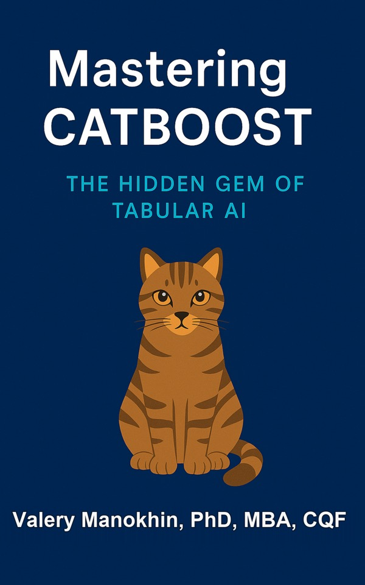

# Awesome CatBoost 

Curated by [Valeriy Manokhin, PhD, MBA, CQF](https://valeriy.ai).

## Mastering CatBoost

**Mastering CatBoost: The Hidden Gem of Tabular AI** is the practical companion
to this list. It follows CatBoost from ordered statistics and symmetric trees
through tuning, uncertainty, ranking, feature engineering, interpretability,
and deployment.

- [Paperback on Amazon (ISBN 978-1-919012-43-8)](https://www.amazon.com/s?k=9781919012438)
- [Hardcover on Amazon (ISBN 978-1-919012-44-5)](https://www.amazon.com/s?k=9781919012445)
- [Core edition on Gumroad](https://valeman.gumroad.com/l/MasteringCatboost)
- [Pro companion on Gumroad](https://valeman.gumroad.com/l/MasteringCatBoostPro)
- [Public code and notebooks](https://github.com/valeman/mastering-catboost)
- [Chapter-by-chapter additional materials](ADDITIONAL_MATERIALS.md)

The Amazon links search by ISBN until the print listings are active. The
Gumroad links are the maintained purchase pages.

## What was added

This repository now includes a maintained companion layer for the book:

- 119 runnable book listings with matching notebooks in the public code repository.
- A chapter-by-chapter map from the book to the relevant CatBoost APIs, tutorials, and research papers.
- Curated starting points for ordered statistics, tuning, uncertainty, ranking, feature engineering, calibration, SHAP, export, MLOps, and causal/propensity workflows.
- Primary-source links for CatBoost, conformal prediction, tabular benchmarks, SHAP, MLflow, DVC, Feast, and FastAPI.
- Dataset and experiment-hygiene guidance covering validation boundaries, schema recording, seeds, horizons, and reproducibility.

Start with the [additional materials guide](ADDITIONAL_MATERIALS.md), then open
the [book listing index](https://github.com/valeman/mastering-catboost/blob/main/book_code/INDEX.md)
to jump directly into runnable examples.

## Why CatBoost is worth studying

CatBoost is a gradient-boosted decision-tree library with native support for
categorical, text, and embedding features. Comparative studies are useful
context, not universal guarantees: results depend on the dataset, protocol,
feature representation, and compute budget. This repository collects the
papers, tutorials, benchmarks, and production references needed to test those
claims rather than repeat them.

- [Official CatBoost documentation](https://catboost.ai/docs/en/)
- [Official CatBoost tutorials](https://github.com/catboost/tutorials)
- [CatBoost: Unbiased Boosting with Categorical Features](https://proceedings.neurips.cc/paper_files/paper/2018/file/14491b756b3a51daac41c24863285549-Paper.pdf)
- [CatBoost: Gradient Boosting with Categorical Features Support](https://arxiv.org/abs/1810.11363)
- [Large-scale tabular benchmark: TabArena](https://arxiv.org/abs/2506.16791)

## [Table of Contents](#table-of-contents)

* [Events](#events)

* [Books](#books)

* [Mastering CatBoost](#mastering-catboost)

* [PhD and MSc Theses](#theses)

* [Videos](#videos)

* [Benchmarks](#benchmarks)

* [Additional materials](#additional-materials)
 
* [Papers](#papers)

* [Papers Time Series](#papers-time-series)

* [Articles](#articles)

* [Kaggle](#kaggle)

* [Tutorials](#tutorials)

* [Courses](#courses)

* [Presentation_slides](#presentation-slides)

* [Researchers](#researchers)

* [Websites](#websites)

* [Twitter](#twitter)

* [TikTok](#tiktok)

* [Conferences](#conferences)

* [Python](#python)  

* [R](#r)

* [Julia](#julia) 

* [Other Languages](#other-languages)

* [AI platforms](#ai-platforms)

* [Patents](#patents)

* [Miscellaneous](#miscellaneous)

* [Contributing](#contributing)

## Additional materials

The new [additional materials guide](ADDITIONAL_MATERIALS.md) maps the book's
chapters to the public code, official CatBoost tutorials and documentation,
primary research papers, uncertainty/ranking/interpretability resources, and
production tools such as MLflow, DVC, Feast, and FastAPI. It is curated as a
learning path rather than a claim that one model wins on every dataset.

## Videos
1. [Anna Veronika Dorogush - CatBoost - the new generation of Gradient Boosting](https://www.youtube.com/watch?v=oGRIGdsz7bM) (EuroPython Conference, 2018)
2. [XGBoost ❌ LightGBM ❌ CatBoost ❌ Scikit-Learn GRADIENT BOOSTING Performance Compared](https://www.youtube.com/watch?v=yO6gJM_t1Bw)
3. [Yandex Catboost: Open-source Gradient Boosting Library](https://www.youtube.com/watch?v=s8Q_orF4tcI) (2018)
4. [CatBoost Part 1: Ordered Target Encoding](https://www.youtube.com/watch?v=KXOTSkPL2X4) by Josh Starmer (2023)
5. [Mastering CatBoost](https://www.youtube.com/watch?v=WQdeDxmz5BU) 
6. [The Strategic Showdown CatBoost vs XGBoost vs LightGBM](https://www.youtube.com/watch?v=0vUKG35OmR8) 🔥🔥🔥🔥🔥🚀

## Benchmarks 
1. [TabArena: A Living Benchmark for Machine Learning on Tabular Data](https://arxiv.org/abs/2506.16791) [TabArena](https://huggingface.co/spaces/TabArena/leaderboard)
2.  [A Closer Look at Deep Learning on Tabular Data](https://arxiv.org/abs/2407.00956) large scale study (300! datasets) showing CatBoost dominates on tabular data 🔥🔥🔥🔥🔥🚀🚀🚀🚀🚀 [code](https://github.com/qile2000/LAMDA-TALENT)
3. [When Do Neural Nets Outperform Boosted Trees on Tabular Data?](https://arxiv.org/pdf/2305.02997v3.pdf) (2023) — a large comparison whose results vary by dataset and protocol.
4.   [A Comprehensive Benchmark of Machine and Deep Learning Across Diverse Tabular Datasets](https://arxiv.org/abs/2408.14817) (2024) 🔥🔥🔥🔥🔥 large scale study showing CatBoost dominates on tabular data
5.   [CatBoost vs XGBoost](https://mljar.com/machine-learning/catboost-vs-xgboost/)

## Papers
1. [A Closer Look at Deep Learning on Tabular Data](https://arxiv.org/abs/2407.00956) large scale study (300! datasets) showing CatBoost dominates on tabular data 🔥🔥🔥🔥🔥🚀🚀🚀🚀🚀 [code](https://github.com/qile2000/LAMDA-TALENT)
2.  [CatBoost: gradient boosting with categorical features support](http://learningsys.org/nips17/assets/papers/paper_11.pdf) by Anna Veronika Dorogush, Vasily Ershov, Andrey Gulin (NeurIPS, 2017) 🔥🔥🔥🔥🔥
3.   [CatBoost: unbiased boosting with categorical features](https://arxiv.org/abs/1706.09516) by Liudmila Prokhorenkova, Gleb Gusev, Aleksandr Vorobev, Anna Veronika Dorogush, Andrey Gulin (Neurips, 2018) 🔥🔥🔥🔥🔥
4. [KiDS-SQuaD: Machine learning selection of bright extragalactic objects to search for new gravitationally lensed quasars](https://www.aanda.org/articles/aa/full_html/2019/12/aa36006-19/aa36006-19.html) (2019)
5. [When Do Neural Nets Outperform Boosted Trees on Tabular Data?](https://arxiv.org/pdf/2305.02997v3.pdf) (2023)
6. [CatBoost for big data: an interdisciplinary review](https://pubmed.ncbi.nlm.nih.gov/33169094/) (Hancock and Khoshgoftaar, 2020)
7.   [A Comprehensive Benchmark of Machine and Deep Learning Across Diverse Tabular Datasets](https://arxiv.org/abs/2408.14817) (2024) 🔥🔥🔥🔥🔥 large scale study showing CatBoost dominates on tabular data

## Articles 
1. [CatBoost Hyperparameter Tuning Guide with Optuna](https://forecastegy.com/posts/catboost-hyperparameter-tuning-guide-with-optuna/) by Mario Filho (2023)
2. [XGBoost? CatBoost? LightGBM?](https://www.joinplank.com/articles/xgboost-catboost-lightgbm) (2023)
3. [When to Choose CatBoost Over XGBoost or LightGBM](https://neptune.ai/blog/when-to-choose-catboost-over-xgboost-or-lightgbm) (2023)
4. [CatBoost vs. LightGBM vs. XGBoost](https://www.kdnuggets.com/2018/03/catboost-vs-light-gbm-vs-xgboost.html)
5. [What Is CatBoost?](https://builtin.com/machine-learning/catboost) by Artem Oppermann (2023)
6. [CatBoost Secrets: How It Handles Categorical Columns and Tree Growth](https://medium.com/@gneyapandya1234/catboost-secrets-how-it-handles-categorical-columns-and-tree-growth-b2ae9b96284b) by Gneya Pandya (2024)
7. [How CatBoost encodes categorical variables](https://towardsdatascience.com/how-catboost-encodes-categorical-variables-3866fb2ae640) by Adrian Biarnes (2021)

## Kaggle 
1. [catboost uncertainty](https://www.kaggle.com/code/raddar/catboost-uncertainty) by x4 Kaggle Grandmaster Darius Barušauskas (Kaggle 'raddar') (2024) 🔥🔥🔥🔥🔥
2. [Probabilistic forecasting I: Temperature](https://www.kaggle.com/competitions/probabilistic-forecasting-i-temperature/discussion/524303) (2024) 🔥🔥🔥🔥🔥

## About the curator

[Valeriy Manokhin, PhD, MBA, CQF](https://valeriy.ai) curates this list and
maintains the companion book and code repository.
